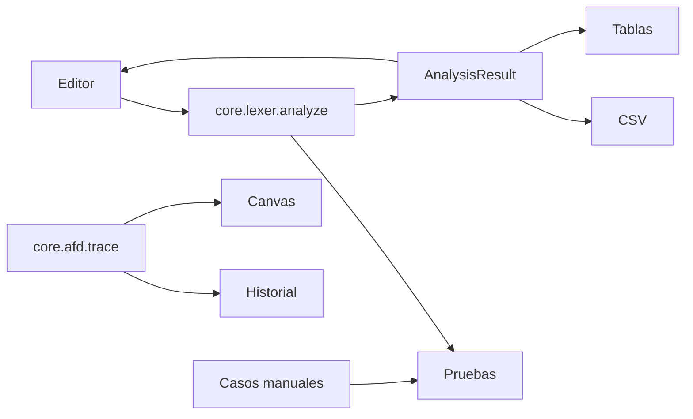

# Arquitectura

`main.py` crea `MainWindow`. La barra lateral instancia cada vista al abrirla por primera vez. Al navegar, la ventana oculta la vista anterior y conserva sus widgets y datos. Al salir del simulador se cancela cualquier reproducción programada.

## Recorrido léxico

1. Lee el carácter en el índice actual. La columna es su distancia al inicio de la línea más uno. Un salto LF, CRLF o CR avanza una línea y reinicia el conteo de columnas.
2. Si es espacio o tabulación, avanza un carácter.
3. Si comienza un bloque alfanumérico ASCII, consume todo el bloque. Valida su contenido con `fullmatch` para identificador y entero. Si ambos patrones fallan, registra el bloque completo como error.
4. Fuera de un bloque, clasifica los símbolos permitidos o registra un error de un carácter.
5. Al terminar, asigna el estado según la presencia de errores y tokens. Mide el tiempo con `perf_counter`.

El recorrido del motor tiene tiempo O(n). Los bloques son disjuntos y sus patrones no tienen alternativas ambiguas. La memoria depende de los lexemas y diagnósticos retenidos. La vista usa las líneas y columnas para aplicar etiquetas de color y seleccionar fragmentos. Una modificación invalida el resaltado hasta repetir el análisis o restaurar la cadena exacta.

## Decisiones técnicas

El núcleo usa dataclasses y módulos estándar, de modo que unittest lo puede ejecutar sin Tk. Las tablas usan Treeview para desplazamiento y selección. Canvas dibuja las aristas y estados del AFD. El temporizador `after()` permite pausar la reproducción y seguir usando la ventana. El servicio CSV usa UTF-8 con BOM y conserva el orden de aparición en la exportación del análisis.
