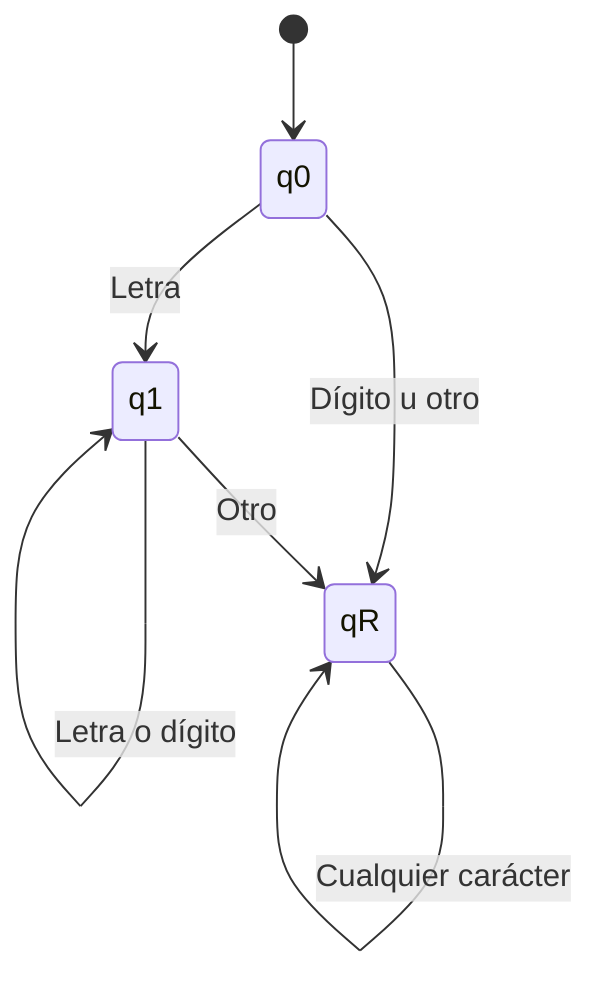

# AFD de identificadores

El AFD reconoce `[A-Za-z][A-Za-z0-9]*`. q0 es el estado inicial, q1 es el único estado de aceptación y qR es el estado trampa. El alfabeto de entrada se divide en tres categorías.

| Estado | Letra ASCII | Dígito ASCII | Otro |
| --- | --- | --- | --- |
| q0 | q1 | qR | qR |
| q1 | q1 | q1 | qR |
| qR | qR | qR | qR |

La aceptación se comprueba al consumir toda la cadena. La cadena vacía termina en q0 y se rechaza.

| Entrada | Recorrido | Resultado |
| --- | --- | --- |
| A | q0 → q1 | Aceptada |
| Total2 | q0 → q1 → q1 → q1 → q1 → q1 → q1 | Aceptada |
| 9abc | q0 → qR → qR → qR → qR | Rechazada |

La simulación calcula el historial con la tabla de transiciones. Avanzar agrega un paso visible y retroceder lo retira. El diagrama marca el estado y la arista activos. Pausar, reiniciar, editar la entrada o abandonar la vista cancela el temporizador. La prueba del AFD se hace sobre la cadena completa, de forma independiente al motor que clasifica los lexemas.
